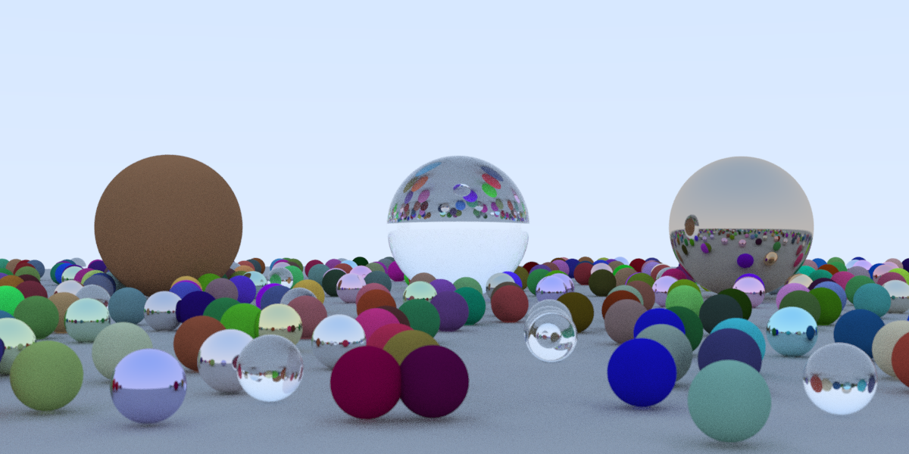

# raytracing-goose

Ray tracing in a weekend in [Goose](https://aardappel.github.io/goose/), ported from
[raytracing-bend2](https://github.com/aguspiza/raytracing-bend2), which was ported from
[raytracing-nim](https://github.com/aguspiza/raytracing-nim).



## Run

Goose compiles to one C file. `goose build` drives a C compiler for you, but it
builds with `-O2`, and gcc only vectorizes the hit test at `-O3`. So emit the C
and build it yourself:

```
goose -O2 --standalone -o main.c main.goose
gcc -O3 -march=native main.c -o ray -lm -pthread
./ray                  # 64 samples per pixel -> ray.tga
./ray 16               # 16 samples per pixel
./ray 16 ppm           # also write ray.ppm (P3)
./ray 16 --threads 1   # cap the worker threads (default: every CPU)
```

`goose build main.goose && ./main` also works, and is slower (see below).
On Windows the same build works with MinGW gcc, adding
`-Wa,-muse-unaligned-vector-move`: without it, gcc's 32-byte AVX stack spills
crash under Win64.

## Same image as Bend

The math, the random numbers and the scene are those of the Bend port,
operation by operation and all in f32:

- the xorshift32 state seeded per pixel from its index, and the hashed cell
  numbers for the scene,
- `randInSphere` and `randInDisk` accepting points *outside* the unit ball
  and giving up after 64 redraws, as in `v3.nim`,
- the sphere order of Bend's scene list (ground, cells from last to first,
  then the three big spheres), so a tie between two spheres goes the same way.

The result: at 4 and at 64 samples per pixel, `ray.tga` is byte-identical to
the one raytracing-bend2 writes. `bench.sh` checks it on every run.

## Optimizations

None of these change a single output byte.

- **Spheres as flat arrays.** The hit test reads centers and `r * r` from four
  `f32` arrays (16 bytes per sphere), not a list of sphere records. Materials
  sit in their own array and are read once, for the sphere that was hit.
- **Two passes over the spheres.** The first pass has no branches: it writes
  `qb` and `disc` for all 486 spheres into two scratch arrays, so the C
  compiler turns it into AVX code, 8 spheres at a time. The second pass takes
  the `sqrt` and the divisions only for the few spheres with `disc > 0`. Bend's
  `Sphere.hit` computes both roots for every sphere.
- **No bounds checks in the loop.** One `assert` on the array lengths lets the
  compiler drop every index check in both passes (`goose check --bce-lines`
  shows 0 kept).
- **Threads that share nothing.** Goose has no shared memory: each worker is a
  separate program with its own copy of the globals. Each one builds its own
  copy of the scene (it is a pure function of the cell index), takes rows from
  a queue, and sends each finished row back as one flat value.

What each step is worth, 1 thread, 4 samples per pixel:

| Hit test                                      | C compiler                | Wall time |
| --------------------------------------------- | ------------------------- | --------- |
| One pass, `sqrt` for every sphere (like Bend) | clang `-O2`               | 9.6 s     |
| One pass, `sqrt` only when `disc > 0`         | clang `-O2`               | 7.5 s     |
| One pass, `sqrt` only when `disc > 0`         | clang `-O3 -march=native` | 6.6 s     |
| One pass, `sqrt` only when `disc > 0`         | gcc `-O2`                 | 5.8 s     |
| Two passes, first one vectorized              | gcc `-O2`                 | 7.5 s     |
| Two passes, first one vectorized              | clang `-O2`               | 3.5 s     |
| Two passes, first one vectorized              | clang `-O3 -march=native` | 2.8 s     |
| Two passes, first one vectorized              | gcc `-O3 -march=native`   | **2.4 s** |

The two-pass version is slower than the one-pass one until the compiler
vectorizes it, which gcc does only at `-O3` and clang already does at `-O2`
(`gcc -fopt-info-vec` reports the first pass vectorized with 32-byte vectors).
Skipping spheres behind the ray origin before the `sqrt` made no difference,
so it is gone.

## Timing

1200x600, WSL2 on a 16-thread CPU (Ryzen 7 5700U), median of 3 runs.
Goose v2026.3 with gcc 13.3. Nim is the `fix-threads-and-cross` branch of
raytracing-nim, built with Nim 2.2.10 and `-d:release`. Bend is
raytracing-bend2 built with Bend 2.0.39 (see the note below).

| 4 samples per pixel          | Wall time | Peak RAM |
| ---------------------------- | --------- | -------- |
| Nim, `--threads:off`         | 18.9 s    | 11 MB    |
| Nim, `--threads:on`          | 3.2 s     | 14 MB    |
| Bend, 1 thread               | 30.0 s    | 48 MB    |
| Bend, 16 threads             | 4.9 s     | 48 MB    |
| Goose, 1 thread              | 2.4 s     | 6 MB     |
| Goose, 16 threads            | 0.35 s    | 6 MB     |

| 64 samples per pixel, 16 threads | Wall time | Peak RAM |
| -------------------------------- | --------- | -------- |
| Nim                              | 52.5 s    | 14 MB    |
| Bend                             | 81.2 s    | 48 MB    |
| Goose                            | 5.6 s     | 6 MB     |

Goose on 16 threads scales 6.7x over 1 thread, Nim 5.9x and Bend 6.1x.

These numbers compare three ports, not three compilers. Most of the gap is in
how each one is written: the Nim code returns `Option`s and keeps materials as
`ref` objects, Bend walks a linked list of spheres, and this port lays the
spheres out for SIMD. Nim's time barely moves with `-march=native` (18.2 s) or
`-d:danger` (18.4 s), so it is not losing on code generation.

`./bench.sh [samples] [runs]` builds all three and prints these tables. It
expects raytracing-nim and raytracing-bend2 checked out next to this repo.

### Bend 2.0.39 and raytracing-bend2

Bend changed two things since raytracing-bend2 was written: `IO.args()` now
starts with the program name, as C's `argv[0]`, and runtime options go between
`+RTS` and `-RTS`. So `./ray 4` renders at 64 samples (it reads `./ray` as the
sample count, fails, and falls back to the default), and the thread cap is now
`./ray 4 +RTS --threads 1 -RTS`. `bench.sh` patches a copy of `main.bend` to skip
the program name before building it.

## Compile time

A full build from source, median of three runs.

| Build                                    | Wall time | Compiler peak RAM |
| ---------------------------------------- | --------- | ----------------- |
| Goose, emit C and gcc `-O3`              | 1.0 s     | 61 MB             |
| Nim 2.2.10, `-f -d:release --threads:on` | 2.6 s     | 87 MB             |
| Bend, full build (`-o ray`)              | 2.9 s     | 136 MB            |

Goose itself takes a few hundredths of a second to check the program and emit
the C. gcc takes the rest.

## Binary size

| Executable, stripped   | Size    |
| ---------------------- | ------- |
| Goose                  | 47 KB   |
| Bend `ray`             | 122 KB  |
| Nim, `--threads:on`    | 134 KB  |

## Memory

Goose has no heap allocator and no garbage collector: every value lives on a
data stack and goes away when its scope ends. The 6 MB peak is the 2.2 MB image
in RGB, the 2.2 MB targa built from it, and the runtime. Each worker holds its
own copy of the scene (about 20 KB) and one row at a time.
